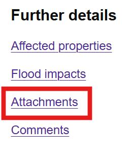
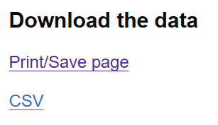

# Flood events

Upgrading a saved search to a flood event lets you add additional information and start flood investigations for each report included.

## Upgrade a saved search to a flood event

When you have your [saved search](saved-search.md) ready, click on the 'Create flood event' button at the bottom of the page.

On the next page, fill in the flood event name - some information will be filled in already and you can change it as you need to. Try and keep the name descriptive following this naming convention:

Date - Location - Flood type

**Example:** 
2026 20-22 October - Dorchester - River

Add any other details you have, including status and estimated totals of properties affected.

Click on 'Save flood event' when you're done.

## Adding and viewing attachments

On the flood event screen, click on 'Attachments'.

If a flood event already has attachments, you can view them. To add new attachments, click on the 'Upload attachments' button.

You can add images, videos and documents.

!!! warning Please ensure there are no identifiable people or personal data in your uploaded files.

### Create a public URL for media uploads

You can create a URL or QR code to share with members of the public that will let them upload media of their own. These links will work for two weeks and you can lock them sooner if you need to.

To create a sharable URL and QR code, click on the 'Generate Public Upload URL' button on the flood event page.

## Adding comments

To do

## Adding property estimates

To do

## Adding flood impacts

To do

## Setting the status

To do

## Downloading data

Download and print a PDF of a flood event, or download a CSV by using the links in the Download section.

