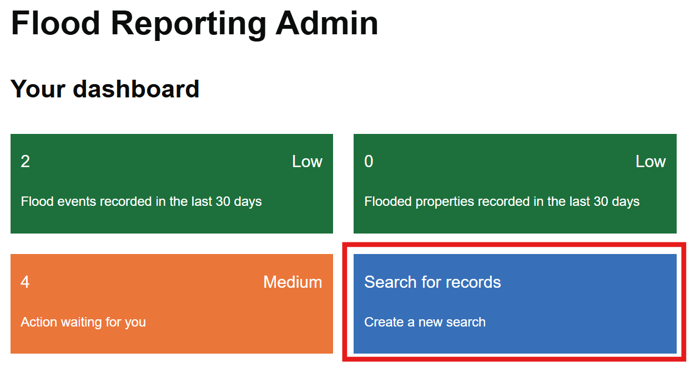
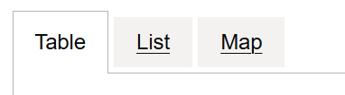

# Saved searches

Create a saved search when you suspect or become aware of flooding. The reference number created from this can be shared with team members and used for monitoring.

## Creating a saved search

Click on the 'Search for records' button on the dashboard.

If you know the reference number of a flood event, you can use it to search. Otherwise, click on 'No' and you'll be able to search using other flood details.

You can search by:

- Date range
- Reports by a person's name
- Postcode
- Flood source type
- Geographical area

Click on Save and any results found will be displayed in a table. You can also look at results in a list or on a map.

## What next?

Your search is now saved. You can go on to [create a flood event](flood-events.md) from your saved search if you need to.
